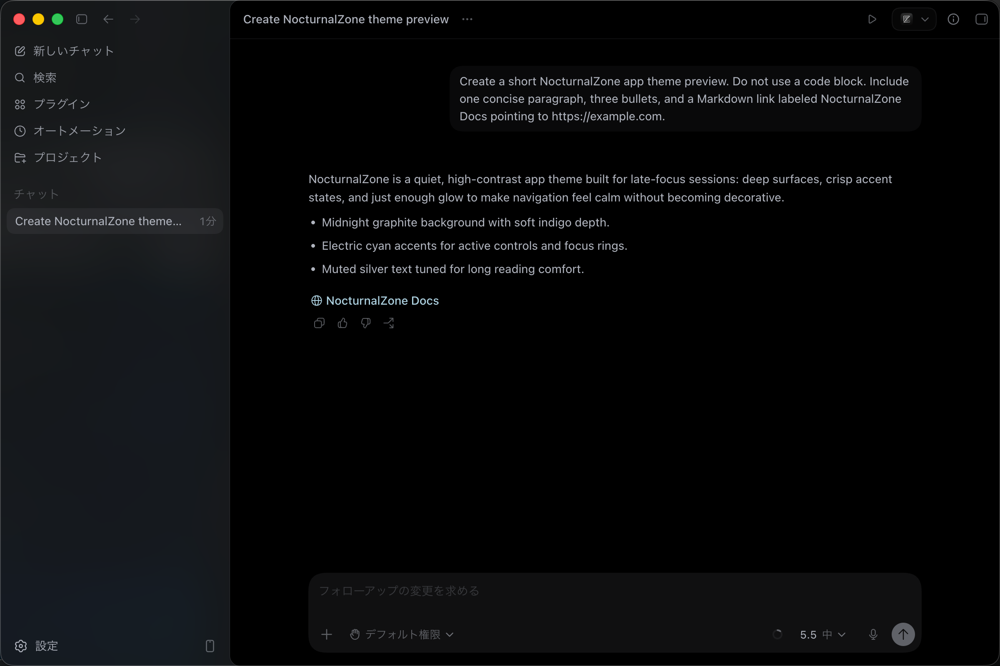
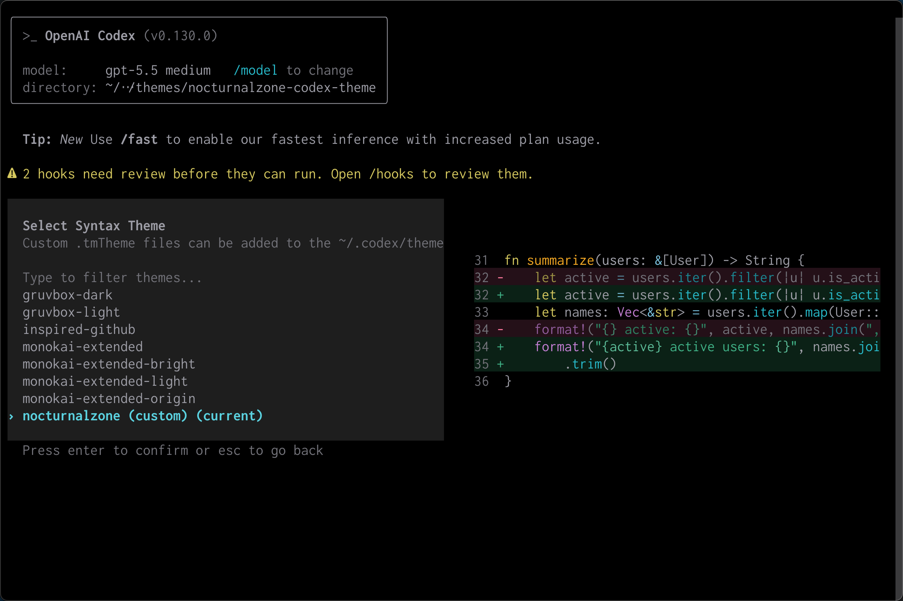

# NocturnalZone Codex Theme

NocturnalZone theme files for Codex.





This repository provides two formats:

- `nocturnalzone-codex-theme.txt` for the Codex app appearance import
- `nocturnalzone.tmTheme` for Codex CLI syntax highlighting

The palette follows the shared NocturnalZone design tokens: absolute black background, restrained neutral text, blue/cyan structure colors, green literals, warm type and diff colors, and low-glare contrast for long coding sessions.

## Codex App

Use `nocturnalzone-codex-theme.txt` from the Codex app appearance settings.

1. Open Codex app settings.
2. Go to Appearance.
3. Use the theme import control.
4. Select `nocturnalzone-codex-theme.txt`.

The app theme file uses Codex's exported `codex-theme-v1:` format.

## Codex CLI

Install directly from GitHub:

```sh
mkdir -p ~/.codex/themes
curl -fsSL https://raw.githubusercontent.com/noxyzone/nocturnalzone-codex-theme/main/nocturnalzone.tmTheme \
  -o ~/.codex/themes/nocturnalzone.tmTheme
```

Or install from a local checkout:

```sh
mkdir -p ~/.codex/themes
cp nocturnalzone.tmTheme ~/.codex/themes/
```

Then open Codex CLI and run:

```text
/theme
```

Select `nocturnalzone`.

## Workspace Install Script

In the NocturnalZone workspace, the shared installer also copies this theme:

```sh
/Users/noxy/nocturnalzone/scripts/theme-install.sh
```

That script installs the Zed, WezTerm, Xcode, and Codex CLI NocturnalZone themes into their local destinations.

## Files

| File                            | Purpose                  |
| ------------------------------- | ------------------------ |
| `nocturnalzone.tmTheme`         | Codex CLI TextMate theme |
| `Twilight.tmTheme`              | Twilight base reference  |
| `nocturnalzone-codex-theme.txt` | Codex app import theme   |

## Design

`nocturnalzone.tmTheme` keeps Twilight's broad TextMate scope coverage while replacing the palette with NocturnalZone colors.

Core syntax mapping:

| Scope group                          | Color     |
| ------------------------------------ | --------- |
| Background                           | `#000000` |
| Foreground                           | `#9d9da6` |
| Comments                             | `#787879` |
| Keywords, tags, links                | `#79c0dc` |
| Functions, support functions         | `#27b8c8` |
| Types, storage, CSS values           | `#d6c95f` |
| Strings                              | `#3fb085` |
| String escapes                       | `#5cbc98` |
| Regex strings                        | `#5bd2e0` |
| Constants, attributes, preprocessors | `#c47fd4` |
| Properties, entities, changed diff   | `#f4a823` |
| Deleted diff, errors                 | `#ff7a9e` |

## License

MIT License. See `LICENSE`.
